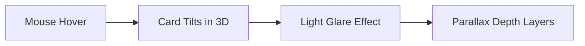
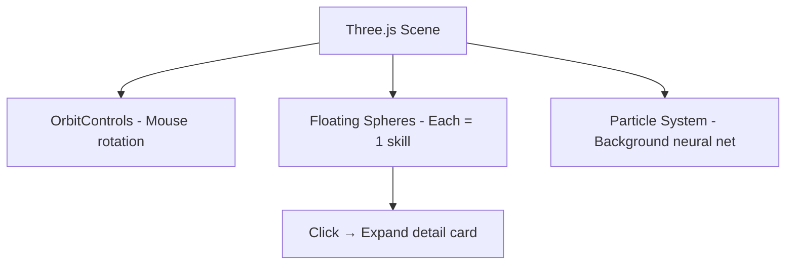
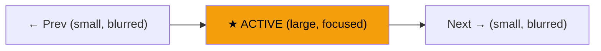

# 🚀 Portfolio 3D Upgrade & Picture Slide — Full Proposal

> [!IMPORTANT]
> তোমার portfolio already অনেক ভালো base আছে — Neural Network canvas, CyberHead 3D intro, glassmorphism cards। এখন 3D আর Picture Slide add করলে এটা **world-class level** হয়ে যাবে। নিচে সব detail explain করলাম।

---

## ✅ Short Answer: হ্যাঁ, ভালো হবে!

তোমার site-এ 3D add করা **100% unique** করবে কারণ:
- বেশিরভাগ portfolio site flat 2D — তুমি 3D করলে **instantly stand out** করবে
- তোমার CyberHeadIntro already canvas-based 3D করেছো — so full 3D direction-এ যাওয়া natural
- Picture slide তোমার projects/personal gallery-কে alive করবে

---

## 🎯 3D Ideas যেগুলো তোমার Website-কে Unique করবে

### 💡 Idea 1: **3D Tilting Project Cards** (Recommended — সবচেয়ে সহজ ও effective)

```
কী হবে: Project cards mouse hover করলে 3D perspective-এ tilt করবে।
         Card-এর উপর light reflection effect আসবে (holographic feel)।
         
কেন Unique: একটা card-এর ওপর mouse নিলে মনে হবে real physical card ধরে ঘুরাচ্ছো।
```



**Technical**: Pure CSS `perspective` + `transform: rotateX/rotateY` + JS mousemove tracking। কোনো library লাগবে না!

---

### 💡 Idea 2: **3D Parallax Scroll Effect** (পুরো page-এ depth feel)

```
কী হবে: Scroll করলে different sections different speed-এ move করবে।
         Background elements পেছনে, foreground elements সামনে — 
         মনে হবে একটা 3D tunnel-এর মধ্য দিয়ে নামছো।
         
কেন Unique: Flat scroll বোরিং, parallax scroll-এ একটা "depth" feel আসে।
```

**Layers:**
| Layer | Speed | Content |
|-------|-------|---------|
| Background | 0.2x | Glow blobs, grid lines |
| Middle | 0.6x | Section titles, decorative elements |
| Foreground | 1.0x | Actual content cards |

**Technical**: CSS `transform: translateZ()` with `perspective` container, বা IntersectionObserver + translateY offset।

---

### 💡 Idea 3: **Three.js 3D Floating Skill Orbs** (Advanced — সবচেয়ে impressive)

```
কী হবে: Skills section-এ flat cards-এর বদলে 3D space-এ floating orbs/spheres থাকবে।
         প্রতিটা orb-এ একটা skill icon/name।
         Mouse move করলে whole scene rotate হবে।
         Click করলে orb zoom-in হয়ে detail দেখাবে।
         
কেন Unique: তোমার AI/ML portfolio-তে 3D neural network visualization
         মানুষের মনে গেঁথে যাবে!
```



**Technical**: `three.js` or `@react-three/fiber` + `@react-three/drei`। ~50KB bundle add হবে।

---

### 💡 Idea 4: **3D Rotating Hero Profile Card** (About section-এ)

```
কী হবে: তোমার profile card (যেটা hero-তে ডানদিকে আছে) — সেটা 3D-তে slowly 
         rotate করবে। সামনে তোমার info, পেছনে stats/skills।
         Mouse hover-এ user নিজেও ঘুরাতে পারবে।
```

---

### 💡 Idea 5: **CSS 3D Page Transitions** (Section change-এ)

```
কী হবে: এক section থেকে আরেক section-এ scroll করলে, section টা 3D flip/fold
         animation দিয়ে transition হবে — যেন page-এর পাতা উল্টাচ্ছো।
```

---

## 📸 Picture Slide Ideas

### Option A: **3D Carousel Slider** (Recommended)

```
কী হবে: Pictures একটা 3D circular carousel-এ ঘুরবে।
         সামনের picture বড়, পাশের গুলো ছোট ও blurred।
         Auto-rotate + drag/swipe support।
         
কোথায় বসাবে: About section-এ বা একটা নতুন "Gallery" section তৈরি করে।
```



### Option B: **Masonry Grid with Lightbox**

```
কী হবে: Pinterest-style grid layout-এ pictures বিভিন্ন size-এ display হবে।
         Click করলে fullscreen lightbox open হবে with smooth zoom animation।
```

### Option C: **Horizontal Scroll Gallery with Parallax**

```
কী হবে: একটা horizontal scrolling strip, scroll করলে pictures parallax effect-এ 
         আসবে-যাবে। Modern, cinematic feel।
```

---

## 🏗️ আমার Recommendation (Best Combo)

> [!TIP]
> সবগুলো একসাথে করলে site heavy হয়ে যাবে। Best approach:

| Priority | Feature | Impact | Difficulty |
|----------|---------|--------|------------|
| 🥇 1st | **3D Tilt Cards** (Projects) | ★★★★★ | Easy |
| 🥈 2nd | **3D Carousel Picture Slide** | ★★★★★ | Medium |
| 🥉 3rd | **Parallax Scroll Depth** | ★★★★☆ | Easy |
| 4th | **3D Floating Skill Orbs** (Three.js) | ★★★★★ | Hard |
| 5th | **3D Page Transitions** | ★★★☆☆ | Medium |

### Recommended Stack:
- **3D Tilt Cards**: Pure CSS + vanilla JS (no extra library)
- **Picture Slide**: Custom CSS 3D carousel (no library needed)
- **Parallax**: CSS transforms + IntersectionObserver
- **Advanced 3D** (optional): `@react-three/fiber` + `@react-three/drei`

---

## ⚠️ Performance Considerations

> [!WARNING]
> 3D effects ভালো দেখায় কিন্তু সাবধানে করতে হবে:

- তোমার **CyberHeadIntro** already একটা heavy canvas animation চালায়
- তোমার **NeuralNetworkHero** also canvas-based particle system চালায়
- আরো Three.js scene add করলে low-end phones-এ lag হতে পারে

**Solution:**
- Mobile-তে 3D effects কমিয়ে রাখবো (graceful degradation)
- `will-change: transform` ব্যবহার করে GPU acceleration নেবো
- Three.js scene লাগলে lazy-load করবো

---

## 🎬 Next Steps

তুমি decide করো কোন features চাও, আমি implement করে দেবো:

1. **Quick Win**: 3D Tilt Cards + Parallax Scroll (কোনো library ছাড়া, আজকেই হয়ে যাবে)
2. **Medium**: 3D Picture Carousel + Tilt Cards (1-2 ঘন্টা)  
3. **Full 3D**: Three.js Skill Orbs + 3D Carousel + Tilt Cards + Parallax (3-4 ঘন্টা)

> কোন option চাও? নাকি specific কোনো idea mix করতে চাও? বলো, শুরু করে দিই! 🔥
